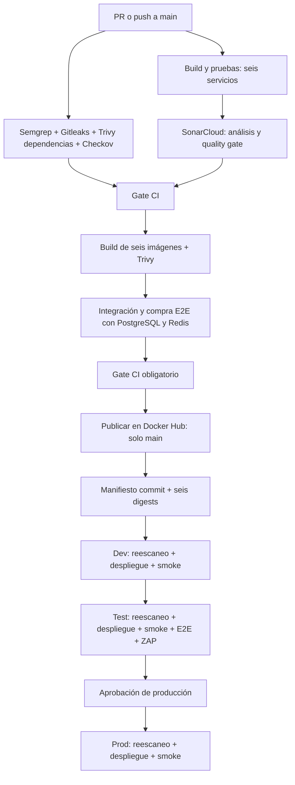

# CI/CD de Tero

## Flujo y correspondencia con el obligatorio

La definición principal es `.github/workflows/pipeline.yml`. Reutiliza `ci.yml`
para validaciones y `deploy.yml` para cada ambiente. Todos los caminos hacia Dev,
Test y Prod dependen de las etapas comunes obligatorias: compilación, pruebas,
calidad, seguridad y publicación. No son tres implementaciones independientes
que puedan desplegar sin pasar esos controles.



- Los PR ejecutan toda la validación y la integración, sin publicar ni desplegar.
- Un push a `main` inicia una release. `workflow_dispatch` permite repetirla;
  la publicación y el despliegue siguen restringidos a `main`.
- Las imágenes se construyen una vez y se conservan como artefactos. Integración
  carga esas imágenes; publicación hace `docker load`, `tag` y `push`, sin build.
- `manifest.json` vincula el SHA con los seis digests de Docker Hub. El mismo
  manifiesto se descarga desde la misma ejecución en cada ambiente. No se acepta
  `latest`, una imagen faltante ni otro SHA.
- Antes de cada despliegue se vuelven a escanear esos digests contra la base de
  vulnerabilidades actual. Un problema nuevo bloquea la promoción.
- Los jobs de Dev, Test y Prod dependen secuencialmente uno del otro. Un job
  fallido, cancelado o salteado bloquea los siguientes. Las releases de `main`
  se serializan, incluyendo la espera de aprobación de Prod.

## Herramientas

| Necesidad | Implementación |
|---|---|
| CI/CD declarativo | GitHub Actions y workflows reutilizables |
| Build | TypeScript, Go y Python; Docker multistage |
| Pruebas | Node test runner + c8, Go test con race detector, pytest + pytest-cov |
| Calidad | SonarCloud, espera de su gate y validación adicional de métricas |
| SAST | Semgrep, reglas locales versionadas en `.semgrep.yml` |
| Secretos en Git y archivos | Gitleaks, historial completo y árbol de trabajo, valores redactados |
| Dependencias e imágenes | Trivy en modo filesystem e image |
| Dockerfiles e IaC | Checkov |
| DAST | OWASP ZAP baseline sobre UI y admin de Test |
| Registro | Docker Hub, seis repositorios `USUARIO/tero-SERVICIO` |
| Despliegue | SSH con host key fijada y Docker Compose |
| Ambientes y aprobaciones | GitHub Environments `dev`, `test`, `prod` |
| Evidencias | GitHub Actions Artifacts |

Las reglas locales de Semgrep son una base para SQL interpolado, evaluación
dinámica y ejecución de shell en los lenguajes del proyecto. Se pueden ampliar
para lo exigido por la sección 5. Checkov exige healthcheck, usuario no root e
imágenes base versionadas en los seis Dockerfiles; si se agregan archivos
Terraform, también ejecuta el análisis de Terraform. No se provisiona infraestructura
AWS como parte de este punto.

## Umbrales y bloqueo

Los umbrales de calidad, Trivy y ZAP están en `.ci/policy.json`.

| Gate | Condición |
|---|---|
| Build y pruebas | Compilan los seis servicios y pasan todos sus tests |
| SonarCloud | Gate remoto aprobado; cobertura nueva ≥ 80 %, duplicación nueva ≤ 3 %, cero bugs y vulnerabilidades nuevos |
| Semgrep | Cero hallazgos en las reglas configuradas; errores de ejecución también bloquean |
| Gitleaks | Cero secretos detectados; se incluye el historial completo |
| Trivy | Cero HIGH o CRITICAL; también bloquean CVEs sin arreglo disponible |
| Checkov | Pasan los controles seleccionados de Dockerfiles y, cuando aplica, Terraform |
| Dev | Los ocho contenedores quedan healthy y pasan los smoke tests |
| Test | Smoke tests, compra completa y ZAP sin alertas High |
| Prod | Test aprobado, revisión humana del Environment y smoke tests |

SonarCloud solo evalúa cobertura nueva si hay líneas nuevas ejecutables. Las
métricas faltantes, reportes inexistentes o errores de red no se convierten en
aprobación. El primer análisis necesita una definición válida del período de
código nuevo en SonarCloud. La cobertura total actual es una línea base; no se
afirma que la aplicación existente tenga 80 % de cobertura global.

El scanner de Cloud descubre los archivos del repositorio. Las pruebas siguen
analizadas, pero se excluyen de los cálculos de cobertura y duplicación mediante
`sonar.coverage.exclusions` y `sonar.cpd.exclusions`. La cobertura de los scripts
Python se genera con `.ci/coverage.ini`, se transporta en el artifact `coverage-ci`
y se importa junto con la de Cart. La normalización conserva rutas relativas al
repositorio y admite ejecutarse nuevamente sin duplicar prefijos. Si el scanner
rechaza el gate después de enviar el análisis, igualmente se intenta guardar
`reports/sonar-measures.json`; el fallo del scanner sigue bloqueando la promoción.

ZAP ejecuta un escaneo pasivo y anónimo: no reemplaza un pentest ni prueba las
rutas autenticadas del admin. Se conservan los reportes y se bloquean los hallazgos
High; Low/Medium quedan visibles. El gate ejecutable de dependencias es Trivy.
`zap_gate.py` recibe JSON por entrada estándar; `manifest.py EXPECTED_SHA` lee
únicamente `manifest.json` en el directorio de la release. Los llamadores de CI
y del despliegue usan esas interfaces, sin rutas libres como argumentos Python.

## Configuración inicial de GitHub y Docker Hub

1. En Docker Hub crear estos seis repositorios, públicos para simplificar el pull:
   `tero-ui`, `tero-admin`, `tero-catalog`, `tero-cart`, `tero-checkout`, `tero-orders`.
2. Crear un token Docker Hub con permiso de escritura y configurar en GitHub
   **Settings → Secrets and variables → Actions**:

   | Secret de repositorio | Valor |
   |---|---|
   | `DOCKERHUB_USERNAME` | Usuario/namespace propietario de los seis repositorios |
   | `DOCKERHUB_TOKEN` | Token de Docker Hub |
   | `SONAR_TOKEN` | Token para analizar el proyecto de SonarCloud |

3. Crear el proyecto en SonarCloud, desactivar análisis automático y seleccionar
   análisis por CI. Configurar estas **variables de repositorio**:

   | Variable | Valor |
   |---|---|
   | `SONAR_PROJECT_KEY` | Clave del proyecto |
   | `SONAR_ORGANIZATION` | Organización de SonarCloud |

   El servicio configurado es `https://sonarcloud.io`. Confirmar que el plan permite
   analizar los lenguajes, la visibilidad y los PR del repositorio. El scanner
   espera el resultado remoto y después verifica los umbrales locales.

4. Crear los ambientes desde la política `.ci/environments.json`, usando GitHub
   CLI autenticado con permisos de administración del repositorio:

   ```bash
   python3 scripts/github_environments.py setup --reviewer TU_USUARIO_GITHUB
   ```

   Esto configura `dev`, `test` y `prod`, permite únicamente `main` y requiere un
   reviewer en Prod. No habilita autoaprobación: la persona debe aprobar en Actions.
   Se permite que un estudiante apruebe su propia ejecución, como en el laboratorio.
   En equipos conviene activar **Prevent self-review** y desactivar el bypass de
   administradores desde Settings. El deploy comprueba las reglas reales por API;
   un Environment creado automáticamente sin protección no permite desplegar.

5. Agregar **a cada Environment** estos secretos, con valores propios por destino:

   | Secret | Valor |
   |---|---|
   | `DEPLOY_HOST` | DNS o IPv4 del servidor Linux; puerto SSH 22 |
   | `DEPLOY_USER` | Usuario con acceso a Docker |
   | `SSH_PRIVATE_KEY` | Clave privada del usuario de despliegue |
   | `SSH_KNOWN_HOSTS` | Entrada verificada de la host key del servidor |

   Se usa `StrictHostKeyChecking=yes`; el workflow no acepta automáticamente una
   clave recuperada por red. No poner contraseñas de la aplicación en los archivos
   de ejemplo ni en artefactos de Actions.

6. Proteger `main`: exigir PR y el check **Required CI gate** del workflow
   principal. Elegirlo después de la primera ejecución; ese job también falla si
   cualquiera de las etapas anteriores quedó salteada.

Los PR desde forks no reciben `SONAR_TOKEN`: el análisis de calidad falla cerrado.
No se usa `pull_request_target` para ejecutar código no confiable con secretos.

## Preparación de los servidores

Se requiere Linux x86_64, Docker Engine, Compose v2 con `up --wait`, Bash, Python 3,
`flock`, `awk`, `tar` y SSH. La app se ejecuta con imágenes `linux/amd64`.
El runner necesita alcanzar el puerto SSH y los servidores necesitan acceso a
Docker Hub y GHCR para descargar imágenes y el escáner ZAP.

Cada ambiente guarda configuración y releases bajo el HOME del usuario SSH:

```text
~/tero/dev/.env
~/tero/test/.env
~/tero/prod/.env
~/tero/<ambiente>/releases/<run-id>-<attempt>/
~/tero/<ambiente>/current -> última release aprobada
~/tero/<ambiente>/previous -> release anterior
```

Copiar el ejemplo correspondiente a `.env` en el servidor, reemplazar todos los
valores de ejemplo por secretos aleatorios distintos y aplicar `chmod 600`.
No basta copiar los ejemplos sin personalizarlos.

Dev usa los puertos 8080/8081; Test 8082/8083; Prod 8084/8085. Esto permite usar
un solo servidor para una demostración, aunque se pueden configurar tres hosts.
Los proyectos Compose `tero-dev`, `tero-test` y `tero-prod` separan redes y
volúmenes. PostgreSQL y Redis no publican puertos del host.

UI y admin escuchan en loopback por defecto. Para acceso público, configurar un
reverse proxy con TLS hacia esos puertos. Los smoke tests y ZAP se ejecutan en el
servidor contra loopback. Los datos de cada ambiente persisten entre releases.
Si las imágenes son privadas, autenticar previamente Docker en cada servidor con
un token de solo lectura. El token de escritura de CI no se envía al servidor.

## Rollback y evidencias

Cada despliegue valida el manifiesto, hace pull por digest y espera healthchecks.
Dev y Prod ejecutan smoke tests; Test también genera una orden de prueba y corre
ZAP. Las órdenes de prueba usan `ci@example.org` y quedan en Test como evidencia;
el carrito temporal se elimina.

Si falla una validación después de iniciar el cambio y hay una release anterior,
se restauran sus imágenes automáticamente. `current` solo avanza al aprobar
todas las validaciones. En el primer despliegue puede no haber una versión para
restaurar. Nunca se ejecuta `down -v` sobre ambientes persistentes.

Rollback manual, desde la release actual en el servidor:

```bash
cd "$HOME/tero/prod/current"
bash scripts/rollback.sh prod "$HOME/tero/prod"
```

El rollback restaura imágenes, no datos ni cambios de esquema. Las migraciones
deben ser compatibles con la release anterior; el `AutoMigrate` existente requiere
revisar esa compatibilidad antes de cambiar modelos.

Actions conserva cobertura, reportes de calidad/seguridad y logs de integración
por 30 días; manifiesto y evidencias de despliegue por 90 días; imágenes temporales
para mover entre jobs por 7 días. El binario de cada servicio se publica dentro de
su imagen. Los contenedores finales usan usuario no root y healthchecks.

## Verificación local

```bash
# Unitarias TypeScript: repetir para ui, admin y checkout, después de instalar deps.
cd src/ui
npm ci --ignore-scripts
npm test

# Checkout usa su Yarn versionado para instalar.
cd ../checkout
node .yarn/releases/yarn-4.11.0.cjs install --immutable
npm test
```

Desde la raíz, usando Python 3.12 y Go 1.26.10:

```bash
python3 -m unittest discover -s tests -v
pip install --require-hashes -r src/cart/requirements-dev.lock
(cd src/cart && python -m pytest --cov=app tests)
(cd src/catalog && go test -mod=readonly -race ./...)
(cd src/orders && go test -mod=readonly -race ./...)

for service in ui admin catalog cart checkout orders; do
  docker build --provenance=false -t "tero-$service:ci" "src/$service"
done
bash scripts/ci-stack.sh
RUN_DAST=true bash scripts/ci-stack.sh

bash scripts/sast.sh
bash scripts/secrets.sh
bash scripts/iac.sh
# Requiere Trivy 0.76.1 en PATH.
bash scripts/trivy.sh fs . reports/dependencies.json
bash scripts/trivy.sh image tero-catalog:ci reports/catalog.json
```

La integración local crea puertos temporales y usa exclusivamente el proyecto
`tero-ci-local`; al terminar elimina sus propios contenedores y volúmenes.
Ejecutarla sin otro proceso de integración local simultáneo. En Actions cada
ejecución usa su propio ID.

## Reproducibilidad y mantenimiento

- Acciones fijadas por SHA; imágenes base y escáneres en contenedores por digest.
- npm usa `npm ci`, Yarn usa `--immutable`, Go usa módulos y `-mod=readonly`.
- Python usa lockfiles completos con hashes y `pip --require-hashes`.
- Las versiones de Node, Go, Python y Trivy están fijadas en los workflows.
- Las reglas SAST y los umbrales están versionados. Las bases de CVEs se actualizan
  para detectar problemas nuevos; un reescaneo puede bloquear una imagen que antes
  estaba aprobada. No se promete identidad bit a bit entre builds independientes.
- Al cambiar Python, regenerar ambos locks con Python 3.12 y pip-tools 7.4.1:

  ```bash
  cd src/cart
  pip-compile --generate-hashes -o requirements.lock requirements.txt
  pip-compile --generate-hashes -o requirements-dev.lock requirements-dev.txt
  ```

El primer escaneo local encontró hallazgos HIGH/CRITICAL en las dependencias
existentes de Go y checkout. El pipeline los bloquea: para obtener una release
aprobada hay que actualizar esas dependencias y volver a validar, además de
configurar las cuentas, secretos y destinos. No se agregaron exclusiones para
ocultar esos hallazgos.

## Mantenimiento de dependencias

Las actualizaciones de dependencias se realizan mediante ramas y PRs del equipo.
Las migraciones mayores se revisan por separado; los controles de Trivy siguen
bloqueando HIGH/CRITICAL, incluidos los que no tienen parche.

Checkout usa TypeScript directamente para compilar, sin Nest CLI, Webpack ni
las herramientas de generación que el servicio no utiliza. El lockfile se
regeneró después de retirarlas. Esto reduce dependencias; queda pendiente
aprobar un escaneo completo con las versiones corregidas de Go y Nest.

Para regenerar y validar las dependencias pendientes con Python 3, Docker y
acceso a los registros, desde la raíz del repositorio:

```bash
bash scripts/remediate-dependencies.sh          # Mostrar la receta
bash scripts/remediate-dependencies.sh --apply  # Regenerar, probar y escanear
```

El script trabaja en `.cache/dependency-remediation.*/` y conserva ahí sus
reportes. Solo copia manifiestos y lockfiles si pasan las pruebas de Go y
checkout y el escaneo completo de los seis manifiestos. Un reporte incompleto,
un hallazgo bloqueante o una edición local concurrente impiden la copia.
No realiza commits ni push. Esta receta todavía no se ejecutó por completo
en un entorno con acceso a Docker y red; sus controles se probaron con Docker
simulado en `tests/test_remediation.py`.
